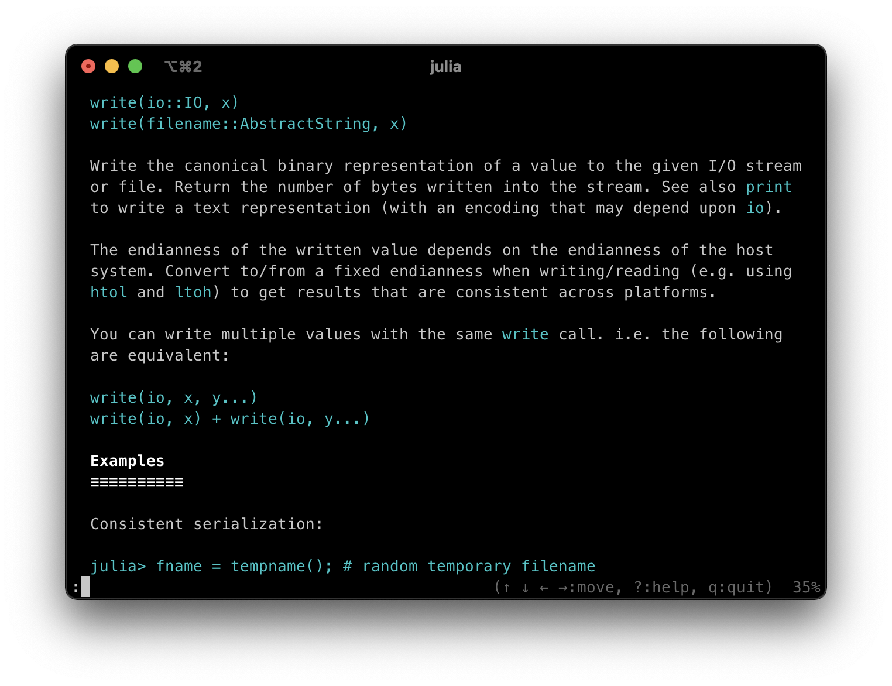
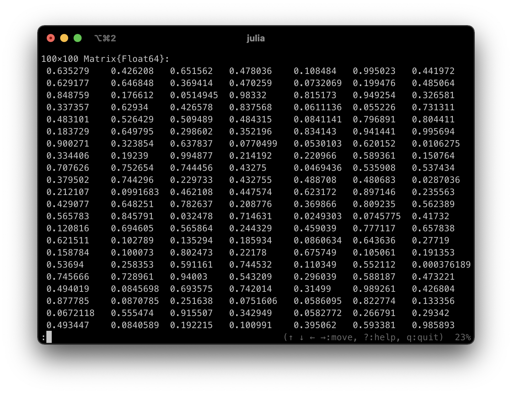
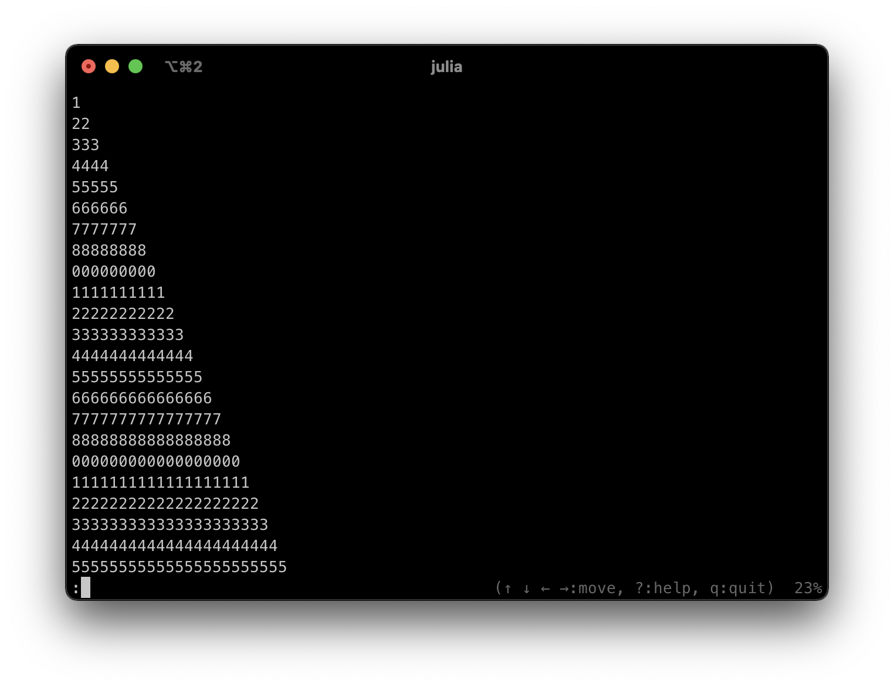

# Usage

## Getting started

The pager is called using the function `pager`. If the input object is not an
`AbstractString`, then it will be rendered using `show` with `MIME"text/plain"`.  Thus, you
can browse a large matrix, for example, using:

```julia-repl
julia> rand(100,100) |> pager
```

It is also possible to use the `pager` to browse the documentation of a specific function:

```julia-repl
julia> @doc(write) |> pager
```

All the functionalities can be seen in the built-in help system, accessible by typing `?`
inside the `pager`.

## Inside the Pager

The last row is a status line with the prompt `❯` in the normal mode, the search or the
visual mode and its state, the enabled features, the key hints of the current mode, whether
the text continues beyond the left or the right edge (`‹` and `›`), and the position (`All`,
`Top`, `Bot`, or a percentage; the preference `"status_position"` shows the top row over the
number of lines instead, or both). The row has no background by default; the face
`status_bar` draws it as a bar (see the [customization](customization.md) page). The
movements follow `less` and Vi: the arrow keys, `j`, `k`, `h`, `l`, `Space`, `PgUp`, `PgDn`,
`Home`, `End`, `g`, and `G`. Typing `:` followed by a position moves the display: a line
number, a percentage of the text like `50%`, an offset from the top row like `+10` or `-5`,
or `$` for the last page. `=` shows the visible lines and columns, the totals, and the
percentage. `r` toggles a line number ruler, which ends with a foot on the last frozen row,
`R` toggles a column ruler on top of the view, `s` toggles a scrollbar, and `q` quits.

The mouse wheel scrolls the text, and `SHIFT` and the wheel scroll it horizontally. Notice
that, while the pager reports the mouse, selecting text with the terminal requires holding
`SHIFT`, or `OPTION` on some terminals. The preference `"mouse"` disables the reporting.

Typing `/` searches for a regular expression. The matches are highlighted while the pattern
is typed, `n` and `N` navigate them, and `ESC` leaves the search. The search is
case-insensitive unless the pattern has an uppercase letter. The up and down keys at the
prompt recall the previous patterns of the session. `Alt+l` at the prompt toggles the literal
mode, shown as `[lit]` and kept for the session, in which the pattern is searched as typed,
so that `a[1]` finds `a[1]` and not `a1`. A regular expression can also quote a part of the
pattern with `\Q` and `\E`. A pattern like `@12:20 14` matches only in the printable
columns 12 to 20, which is handy to search one column of a table; `@12 14` and `@:20 14`
leave one end open, and the column ruler (`R`) helps picking the columns. The status line
shows the range next to the matches.

The visual mode, toggled with `v`, highlights a visual line that the movements and the mouse
move. `M` marks the visual line, `V` anchors a range that follows the visual line until `V`
is pressed again or `M` marks the whole range, and `y` copies the visual line, the range,
and the marked lines to the clipboard. `Enter` copies the selection and quits the pager. `Y`
copies the whole text from any mode. The status line shows how many lines are selected.

The copied lines are also returned to Julia: `TerminalPager.yanked()` returns the lines of
the last copy of the session, and `pager(x; return_selection = true)` returns a
`TerminalPager.PagerResult` with the selection, the viewport, and the search pattern when
the pager quits:

```julia-repl
julia> result = pager(rand(100, 100); return_selection = true);

julia> result.selection
```

`S` saves the whole text, or the selection in the visual mode, to a file without the
decorations; a path starting with `!` keeps them, `~` is expanded, and an existing file is
overwritten only after a confirmation.

`m` followed by a letter bookmarks the top line, or the visual line in the visual mode, and
`'` followed by the letter jumps back to it. `''` returns to the position before the last
jump, search, or `:` goto. The bookmarked lines are marked with `•` in the line number ruler.
The bookmarks last for the session.

Rows and columns can be frozen with `f`, so that they stay visible while scrolling, and `t`
selects how many frozen rows are titles, which do not scroll horizontally either. `F`
selects the frozen rows and columns on the screen: the view moves to the top-left corner,
two guide lines mark the rows and the columns that would be frozen, the movement keys or
the mouse move them, `Enter` applies the selection, and `Esc` cancels it. `T` selects the
title rows the same way with a single guide line, and freezes them if fewer rows were
frozen.

## Helpers

The following macros are available to help calling the pager.

### `@help`

This macro calls the help of any function, macro, or other object and redirects it to the
`pager`:

```julia-repl
julia> @help write
```



You can hit `<Alt> + h` or `<F1>` on any REPL input to get extended help about the identifier
the cursor is currently on. After you exit the pager, you return to the REPL input you had
already typed. If you are in a new argument of a method call, the pager prints extended help
about the function instead, to help you complete the method's argument list.

### `@stdout_to_pager`

This macro redirects all the `stdout` to the pager after the command is completed:

```julia-repl
julia> @stdout_to_pager show(stdout, MIME"text/plain"(), rand(100,100))
```



This macro also works with blocks such as `for` loops:

```julia-repl
julia> @stdout_to_pager for i = 1:100
       println("$(mod(i,9))"^i)
       end
```



!!! note
    This macro can also be called using the shorter name `@out2pr`.

## REPL Modes

**TerminalPager.jl** comes with a REPL mode that automatically renders the command output to
a pager if it does not fit the screen. To access this mode, just type `|` at the beginning
of the REPL command line. If the mode is loaded correctly, the prompt `julia>` is changed to
`pager>`.

In pager mode, you can also type `?` at the beginning of the command line to access the pager
help mode. In this case, the prompt is changed to `pager?>`. Any docstring accessed in this
mode is rendered inside a pager. The pager uses the alternate screen buffer, so the screen
content is restored after exiting it.
